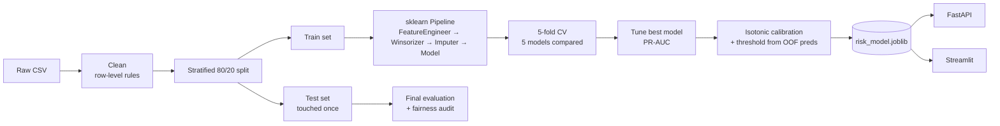

# AI Financial Risk Analyzer

> An end-to-end machine learning system that estimates the probability a credit card client will default on next month's payment, explains every prediction, audits itself for subgroup fairness, and serves results through a REST API and an interactive dashboard.


<!-- TODO: add a screenshot or GIF of the dashboard: docs/screenshots/dashboard.png -->
<!--  -->

---

## Highlights

| | |
|---|---|
| **Problem** | Binary classification on imbalanced data (~22% defaulters) |
| **Data** | UCI *Default of Credit Card Clients*: 30,000 clients, Taiwan, 2005 |
| **Best model (CV PR-AUC)** | XGBoost, tuned and probability-calibrated |
| **Held-out test** | ROC-AUC **0.778**, PR-AUC **0.552** (baseline PR-AUC 0.221) |
| **Serving** | FastAPI (`/predict`, `/predict/batch`) + Streamlit dashboard |
| **Beyond accuracy** | SHAP explanations, calibration, decision threshold, fairness audit |

Accuracy is deliberately not used as a headline metric: predicting "no default" for everyone already scores about 78%.

---

## Architecture



The saved artifact is **one pipeline** (preprocessing + model + calibrator + threshold). The API and dashboard can therefore never apply different preprocessing than training did.

---

## Results

All numbers below come from a real training run on the full dataset (random seed 42). Reproduce them with `python -m src.train`; the raw outputs are in `models/metrics.json` and `reports/cv_results.csv`.

### Cross-validation (5-fold stratified, training set only)

| Model | ROC-AUC | PR-AUC | Precision | Recall | F1 |
|---|---|---|---|---|---|
| **XGBoost** | **0.7865** | **0.5635** | 0.4683 | 0.6339 | 0.5386 |
| HistGradientBoosting | 0.7849 | 0.5618 | 0.4736 | 0.6312 | 0.5412 |
| Random Forest | 0.7818 | 0.5536 | 0.5612 | 0.5175 | 0.5383 |
| Logistic Regression | 0.7614 | 0.5105 | 0.4578 | 0.6231 | 0.5278 |
| Dummy (prior) | 0.5000 | 0.2213 | 0 | 0 | 0 |

Precision, recall and F1 in this table use the default 0.5 probability cutoff. The three tree-based models are within one fold-standard-deviation of each other on PR-AUC (std ≈ 0.01), so XGBoost is best by selection rule, **not by a statistically meaningful margin**.

### Held-out test set (6,000 clients never used for training, tuning or threshold selection)

| Metric | Value |
|---|---|
| ROC-AUC | 0.7781 |
| PR-AUC | 0.5519 |
| Precision (at tuned threshold) | 0.5098 |
| Recall (at tuned threshold) | 0.5694 |
| F1 (derived from the two above) | ≈ 0.538 |
| Brier score (calibrated) | _TODO: copy from `models/metrics.json`_ |
| Decision threshold | _TODO: copy from `models/metrics.json`_ |
| Confusion matrix | _TODO: copy from `models/metrics.json` or `reports/figures/confusion_matrix.png`_ |

**Interpretation**
- Test scores sit close to CV scores (ROC-AUC 0.778 vs 0.787; PR-AUC 0.552 vs 0.564), which is what you expect when there is no leakage or overfitting.
- PR-AUC of 0.55 is about 2.5× the 0.22 no-skill baseline.
- At the chosen threshold, roughly half of flagged clients actually default (precision ≈ 0.51) and roughly 57% of real defaulters are caught (recall ≈ 0.57). That is a useful *ranking and triage* signal, not a basis for automated decisions.
- This dataset is known to be noisy: ROC-AUC values in the high 0.7s are typical for it, and much higher numbers would warrant suspicion of leakage.

---

## Features

### Data science
- **Leakage-safe by construction:** the split happens before any statistic is learned. Winsorization quantiles, imputation values and scaling are fit **inside** the sklearn `Pipeline` on training folds only. Duplicates are removed before splitting.
- **EDA with statistical testing:** missing values, duplicates, IQR outliers, class balance, Spearman correlations, Mann-Whitney U per feature, chi-square tests for categorical variables (`python -m src.eda`).
- **Domain feature engineering** from six months of billing and repayment history: maximum and mean delay, months delayed, delay trend, average/latest/trend credit utilization, over-limit months, repayment ratio.
- **Imbalance handled with class weights** (`class_weight`, `scale_pos_weight`) rather than resampling, so no synthetic samples can leak across folds.
- **Five models compared** with stratified 5-fold CV on ROC-AUC, PR-AUC, precision, recall and F1.
- **Hyper-parameter search** (randomized) optimizing PR-AUC, the metric that matters under imbalance.
- **Calibration and thresholding:** isotonic calibration and the F1-optimal decision threshold are both learned from out-of-fold *training* predictions. The test set is evaluated exactly once.

### Responsible AI
- **Explainability:** per-prediction top contributing features via SHAP (tree models) with a model-agnostic occlusion fallback.
- **Fairness audit:** `sex` and `marriage` are excluded from the model inputs. Subgroup recall, precision, flag rate and calibration by sex, education and age band are written to `reports/fairness_audit.csv`.

### Engineering
- Modular `src/` package, one deliverable pipeline, fixed seeds.
- **FastAPI** with strict Pydantic validation (422 on bad input, 503 if no model is trained), single and batch endpoints.
- **Streamlit** dashboard: single prediction with contribution chart, CSV batch scoring with download, model performance, fairness table, EDA charts.
- Unit tests (`pytest`) and a GitHub Actions workflow.

---

## Quick start

```powershell
# 1. Install
python -m pip install -r requirements.txt

# 2. Get the data (creates data/raw/credit_default.csv, shape (30000, 24))
python -m pip install ucimlrepo
python -c "from ucimlrepo import fetch_ucirepo; d=fetch_ucirepo(id=350); df=d.data.features.copy(); df['default']=d.data.targets.iloc[:,0]; df.to_csv('data/raw/credit_default.csv', index=False)"

# 3. Analyse, train, serve
python -m src.eda
python -m src.train                  # add --no-tune for a faster run
python -m streamlit run app/dashboard.py
python -m uvicorn api.main:app --reload   # http://127.0.0.1:8000/docs
```

Run the tests with `python -m pytest -q`. `python -m src.train --demo` trains on synthetic data purely to smoke-test the code; its numbers are meaningless and the dashboard flags such models with a warning.

On Windows, `.\run.ps1 <eda|train|api|dashboard|test>` wraps these commands. If PowerShell blocks it: `Set-ExecutionPolicy -Scope Process -ExecutionPolicy Bypass; Unblock-File .\run.ps1`.

---

## API

| Method | Path | Purpose |
|---|---|---|
| GET | `/health` | Liveness and whether a model is loaded |
| GET | `/model-info` | Model name, data source, threshold, top features |
| POST | `/predict` | Score one client |
| POST | `/predict/batch` | Score up to 1,000 clients |

**Request**
```bash
curl -X POST http://127.0.0.1:8000/predict -H "Content-Type: application/json" -d '{
 "limit_bal": 120000, "education": 2, "age": 35,
 "pay_1": 2, "pay_2": 2, "pay_3": 0, "pay_4": 0, "pay_5": 0, "pay_6": 0,
 "bill_1": 3200, "bill_2": 2900, "bill_3": 2600, "bill_4": 2400, "bill_5": 2000, "bill_6": 1800,
 "paid_1": 0, "paid_2": 1000, "paid_3": 1000, "paid_4": 800, "paid_5": 800, "paid_6": 700}'
```

**Response shape** (values depend on your trained model)
```json
{
  "risk_probability": 0.0,
  "risk_level": "Low | Medium | High",
  "flagged_high_risk": false,
  "decision_threshold": 0.0,
  "explanation_method": "shap | occlusion",
  "top_factors": [
    {"feature": "pay_1", "value": 2.0, "impact": 0.0, "direction": "increases risk"}
  ]
}
```

Input fields: `pay_1` is the most recent month (September) and `pay_6` the oldest (April). Repayment status: `-2` no consumption, `-1` paid duly, `0` revolving credit, `1`–`9` months of delay. `education`: 1 graduate school, 2 university, 3 high school, 4 other.

---

## Fairness audit

`sex` and `marriage` are not model inputs, but dropping a protected attribute does not make a model fair, because correlated features can act as proxies. After training, `reports/fairness_audit.csv` reports, per subgroup on the test set: size, actual default rate, flag rate, recall, precision and mean predicted probability.

<!-- TODO: after training, paste the recall gaps from models/metrics.json ("fairness_recall_gaps") and 1-2 sentences of interpretation. -->

| Attribute | Recall gap across groups | Notes |
|---|---|---|
| Sex | _TODO_ | |
| Education | _TODO_ | |
| Age band | _TODO_ | Small groups give noisy estimates |

This is a diagnostic, not a certification. Subgroup sample sizes can be small, and a formal fairness review would need legal and domain input.

---

## Project structure

```
ai-financial-risk-analyzer/
├── src/
│   ├── config.py      # paths, seed, column names
│   ├── data.py        # loading, cleaning, synthetic generator (tests only)
│   ├── features.py    # FeatureEngineer, Winsorizer, build_pipeline
│   ├── eda.py         # EDA + statistical tests
│   ├── train.py       # CV, tuning, calibration, evaluation, fairness, saving
│   ├── explain.py     # SHAP / occlusion explanations
│   └── predict.py     # inference used by API and dashboard
├── api/main.py        # FastAPI service
├── app/dashboard.py   # Streamlit dashboard
├── tests/             # pytest suite
├── data/raw/          # dataset (not committed)
├── models/            # trained artifacts (not committed)
├── reports/           # metrics, fairness audit, figures
└── run.ps1            # Windows task runner
```

---

## Design decisions

- **PR-AUC as the selection metric.** Under 22% prevalence it reflects performance on the minority class far better than ROC-AUC or accuracy.
- **Class weights over SMOTE.** Resampling inside CV is easy to get wrong and can leak; weights keep the training distribution honest.
- **Calibration after selection.** Class weighting distorts predicted probabilities, so isotonic regression fitted on out-of-fold predictions restores meaningful probabilities for the dashboard.
- **Threshold from training data only.** Picking it on the test set would make the reported test metrics optimistic.
- **Sensitive attributes out of the model, in the audit.** Keeps decisions free of direct use of sex/marital status while still letting us measure disparities.

---

## Limitations and ethical considerations

- **Narrow data:** one Taiwanese bank in 2005, credit-card default over a single month. The model will not transfer to other countries, products or economic conditions without retraining and validation.
- **Selection bias:** only approved cardholders appear in the data; outcomes for rejected applicants are unknown.
- **Data quirks:** undocumented codes in `EDUCATION` (0, 5, 6) and `MARRIAGE` (0) are mapped to "other".
- **Proxy risk:** age, education and credit limit can still encode information about excluded attributes. The audit surfaces gaps; it does not remove them.
- **Moderate precision:** about half of flagged clients are false alarms and about 43% of defaulters are missed at the tuned threshold.
- **Explanations are not causes:** SHAP and occlusion describe model behaviour, not why a person defaulted.
- **Drift:** calibration and the threshold depend on the ~22% base rate and must be re-fit if the population changes.
- **Not for production credit decisions.** Real use would require legal review (e.g. fair-lending regulation), human oversight, adverse-action explanations and continuous monitoring.

---

## Future work

- Compare with and without `age`/`education` to quantify the accuracy-fairness trade-off
- Threshold selection from a cost matrix instead of max-F1
- Conformal prediction intervals for uncertainty
- Docker image and cloud deployment
- Model monitoring and drift detection

---

## Data source

Yeh, I. C., & Lien, C. H. (2009). *The comparisons of data mining techniques for the predictive accuracy of probability of default of credit card clients.* Expert Systems with Applications, 36(2). Dataset: [UCI Machine Learning Repository, id 350](https://archive.ics.uci.edu/dataset/350/default+of+credit+card+clients).

## License

_TODO: choose a license (e.g. MIT) and add a `LICENSE` file._
